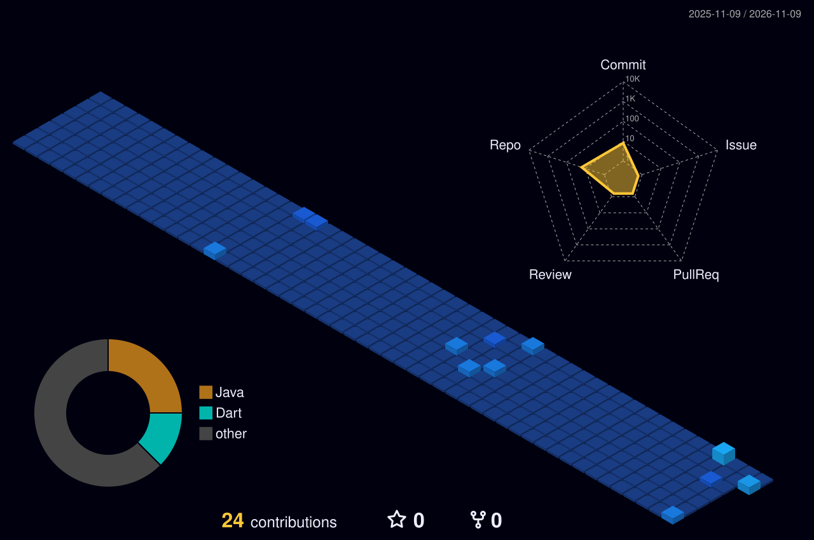

# Hi, I'm Tarun R 👋

**Full Stack & AI/ML Developer**

Building intelligent systems and full-stack products — one commit at a time.

  

 

## 🥷 Flagship Jutsu

<table>
<tr><th>Project</th><th>What it does</th><th>Chakra</th></tr>
<tr><td><b>VKRE</b> Final-year project</td><td>Verified Knowledge Reasoning Engine: a trustworthy AI system with Knowledge, Verification and Generation layers, two novel algorithms (VECA, VFOA) and an MCP orchestrator</td><td><code>LLM</code> <code>RAG</code> <code>MCP</code></td></tr>
<tr><td><b>DisasterMesh</b></td><td>Offline peer-to-peer disaster communication app: Bluetooth/WiFi Direct mesh, AES-256-GCM encryption, AI message prioritisation, English + Tamil</td><td><code>Flutter</code> <code>Dart</code></td></tr>
</table>

<!-- Link the names once repos are public: <a href="https://github.com/Tarun160706/REPO-NAME"><b>VKRE</b></a> -->

## 🍥 S-Rank Missions

<table>
<tr><th>Mission</th><th>What it is</th><th>Jutsu used</th></tr>
<tr><td><a href="https://github.com/Tarun160706/Pro-3-Recruitement"><b>Pro-3-Recruitement</b></a></td><td>Recruitment workflow application</td><td><code>Java</code></td></tr>
<tr><td><a href="https://github.com/Tarun160706/Pro-4-StateSnap"><b>Pro-4-StateSnap</b></a></td><td>State snapshot service</td><td><code>Java</code></td></tr>
<tr><td><a href="https://github.com/Tarun160706/Portfolio-IMP"><b>Portfolio-IMP</b></a></td><td>Personal portfolio — live on Vercel</td><td><code>JavaScript</code></td></tr>
<tr><td><a href="https://github.com/Tarun160706/Pro-5-GeoTracker"><b>Pro-5-GeoTracker</b></a></td><td>Geo-fencing and location tracking</td><td><code>Python</code></td></tr>
<tr><td><a href="https://github.com/Tarun160706/Pro-6-ProjectManagement"><b>Pro-6-ProjectManagement</b></a></td><td>Project management dashboard</td><td><code>JavaScript</code></td></tr>
<tr><td><a href="https://github.com/Tarun160706/Pro-2-GraphRag"><b>Pro-2-GraphRag</b></a></td><td>GraphRAG retrieval pipeline</td><td><code>Python</code></td></tr>
</table>

## ⚡ Chakra Natures (Tech Stack)

LLMs · RAG · MCP · MERN · Mobile · Full-Stack

<a href="https://github.com/Tarun160706?tab=repositories"><b>→ See all 19 repositories</b></a>

  

### 🌃 My contribution village

*Every commit raises another building — rebuilt automatically every day.*

  

 

**Dattebayo — keep coding, keep growing.** 🍥

